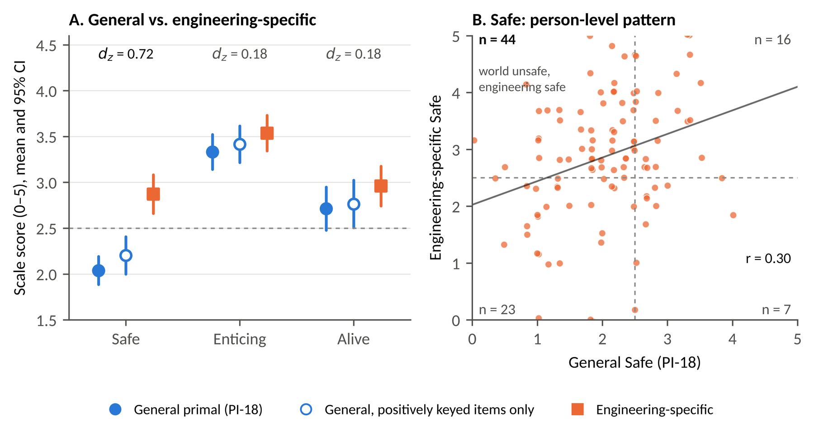

# A Safe Harbour in a Cut-Throat World?

**General and Engineering-Specific Primal World Beliefs Among Indian Engineering Undergraduates**

Ritabrata Chakraborty (University of Pennsylvania)

[](https://ritabrata-chakraborty.github.io/Primal-World-Beliefs-Engineering/) [](docs/paper.pdf) [](Data_code_and_figures/data) [](Data_code_and_figures/scripts)

<p align="center"></p>
<p align="center"><b>Figure 3:</b> Engineering-Specific Versus General Beliefs. (A) Means with 95% CIs. (B) Each Point Is One Student's General Versus Engineering Safe Score</p>

## Summary

**Try it:** the [project page](https://ritabrata-chakraborty.github.io/Primal-World-Beliefs-Engineering/#questionnaire) has an interactive questionnaire (the general PI-18 and the engineering-specific EPB-18) that scores your answers and compares them with this study's averages. Answers never leave your browser.

Primal world beliefs (primals) are people's most basic beliefs about whether the world is Safe, Enticing and Alive. We gave 108 Indian engineering undergraduates (aged 17–25) the 18-item Primals Inventory (PI-18) and 18 new engineering-specific items (EPB-18).

- **A cut-throat world.** Students saw the world as much less Safe than published reference samples (*d* = −1.06). 86.1% agreed that the world is "cut-throat and competitive".
- **Engineering as a safe harbour.** Students rated engineering as much safer than the world (*d*<sub>z</sub> = 0.72, 95% CI [0.51, 1.00]). The gap held when only positively keyed PI-18 items were compared, and it appeared only for Safe, not for Enticing or Alive.
- **Loose coupling.** General primals explained only 12%–22% of the variance in engineering-specific beliefs.
- **Keying effects.** Reverse-keyed PI-18 items formed a method factor. Acquiescence partly inflated the all-positive EPB-18 items, though not the Safe subscale.

## Repository contents

| Path | Contents |
|------|----------|
| `IEEE/` | LaTeX source, compiled PDF and figures of the paper (IEEE journal format) |
| `Data_code_and_figures/data/` | De-identified responses, `pwb_engineering_deidentified.csv` (*N* = 108; state recoded to region, time stamps removed). The codebook is in Supplementary Section S3 of the paper |
| `Data_code_and_figures/scripts/` | `analysis.py` (all statistics), `tables.py` (tables), `figures.py` (figures) |
| `Data_code_and_figures/figures/` | Figures 1–4 as 600-dpi PNGs |
| `docs/` | Source of the GitHub Pages project page |

## Reproducing the results

Requirements: Python 3.11+, with `pandas`, `numpy`, `scipy`, `statsmodels`, `matplotlib`, `factor_analyzer==0.5.1` and `semopy==2.3.11`.

```bash
pip install pandas numpy scipy statsmodels matplotlib \
    "scikit-learn<1.6" factor_analyzer==0.5.1 semopy==2.3.11
cd Data_code_and_figures

# All statistics -> out/results.json
python scripts/analysis.py data/pwb_engineering_deidentified.csv out
# Tables and figures from out/
python scripts/tables.py
python scripts/figures.py
```

The fixed bootstrap seed (`20241013`) reproduces every reported value except the number of states represented and the data-collection dates, which need the raw data. `factor_analyzer` 0.5.1 passes a scikit-learn argument that was later renamed (`force_all_finite` → `ensure_all_finite`). Pin `scikit-learn<1.6` as shown, or make that one-word rename.

## Citation

```bibtex
@misc{chakraborty2026safeharbour,
  title     = {A Safe Harbour in a Cut-Throat World? General and Engineering-Specific
               Primal World Beliefs Among Indian Engineering Undergraduates},
  author    = {Chakraborty, Ritabrata},
  year      = {2026},
  note      = {Preprint},
  url       = {https://ritabrata-chakraborty.github.io/Primal-World-Beliefs-Engineering/}
}
```

## License

The paper, data and figures are licensed under [CC BY-NC-ND 4.0](https://creativecommons.org/licenses/by-nc-nd/4.0/). The analysis code is licensed under the [MIT License](LICENSE).
